  

# 🚀 Awesome Revenue Yield Management & Optimization 📈

  
  
  
  
  
  
  

> 💡 **A comprehensive, SEO-curated directory of top Revenue Yield Management and Optimization platforms** — spanning enterprise SaaS/Hosted commercial solutions, algorithmic dynamic pricing engines, automated demand forecasting systems, and battle-tested open-source repositories for hotels, airlines, vacation rentals, travel tech, and subscription businesses.
>
> 🌟 **Star this repository if you find it helpful!** 🌟

---

## 🧭 Table of Contents

- [🌐 Sector Overview & Market Dynamics](#-sector-overview--market-dynamics)
- [🟦 SaaS / Hosted Platforms](#-saas--hosted-platforms)
- [🟩 Open-Source Software](#-open-source-software)
- [📊 Comparison Matrix](#-comparison-matrix)
- [🔍 SEO Key Concepts & Algorithmic Foundations](#-seo-key-concepts--algorithmic-foundations)
- [🤝 Contributing](#-contributing)
- [💖 Support](#-support)
- [⭐ Star History](#-star-history)
- [📄 License](#-license)

---

## 🌐 Sector Overview & Market Dynamics

The global revenue management software ecosystem represents a rapidly expanding market valued at approximately **$3.7B – $8.7B combined** across aviation ($1.8B–$6.8B) and hospitality ($1.9B+, projected to surpass $4B+ by 2032 at an 8%–14% CAGR). The sector exhibits a distinctive structural dichotomy: it is **moderately-to-highly fragmented across independent hotels, boutique vacation rentals, and regional operators**, yet behaves as a **consolidated, "winner-take-most" oligopoly at the enterprise tier** (e.g., global hotel chains and Tier-1 commercial airlines).

At enterprise scale, mission-critical integration barriers with Central Reservation Systems (CRS) and Property Management Systems (PMS)—combined with massive predictive data moats necessary for real-time continuous dynamic pricing and multi-agent AI offer generation—create formidable competitive lock-in favoring incumbent giants like PROS, SAS (IDeaS), and well-funded cloud disruptors like FLYR Labs. Conversely, the long-tail hospitality and short-term rental market remains highly competitive and fragmented, driving rapid adoption of self-serve SaaS platforms (PriceLabs, Beyond, Wheelhouse, RoomPriceGenie) and community-driven open-source alternatives.

---

## 🟦 SaaS / Hosted Platforms

Below is the curated selection of market-leading commercial Revenue Management Systems (RMS) and dynamic pricing platforms, **sorted in descending order by company scale (Revenue / Market Valuation)**:

| Platform 🏢 | Target Sector 🎯 | Starting Tier Price 💳 | Free Tier / Trial Limit ⏱️ | Company Scale (Revenue / Valuation) 📊 | Key Strengths & Capabilities ⚡ |
|---|---|---|---|---|---|
| **[PROS Revenue Management](https://pros.com/)** | Airlines, Cargo & B2B Commerce | **$60 / user / month** *(PROS Smart CPQ Essentials; Enterprise RM via custom quote starting ~$1,500+/mo)* | **No free trial** *(0 days; private sandbox and customized enterprise evaluation by request)* | **~$1.4B Valuation** *(Delisted from NYSE at $1.4B acquisition by Thoma Bravo; ~$330M annual revenue)* | AI-driven dynamic pricing, continuous pricing, offer/order management, and willingness-to-pay modeling across complex inventory. |
| **[FLYR Labs](https://flyr.com/)** | Airlines, Rail & Hospitality | **$1,000 / month** *(FusioRM entry tier; enterprise airline deployments scale via quote)* | **No free trial** *(0 days; custom onboarding demonstration with client historical data)* | **~$1.1B Valuation** *(Series D raised $295M in Aug 2024; ~$100M+ ARR estimate)* | Deep learning neural networks for continuous pricing, total revenue optimization, and unconstrained demand forecasting. |
| **[IDeaS Revenue Solutions](https://ideas.com/)** | Hotels, Resorts & Parking | **$1,000 / month** *(IDeaS G3 RMS baseline starting rate for mid-sized properties)* | **No free trial** *(0 days; guided software walkthrough & historical revenue uplift audits only)* | **~$439M Revenue** *(Wholly-owned subsidiary of SAS Institute with $3B+ parent revenue)* | The gold standard in hospitality revenue management with automated room-type pricing, group evaluations, and overbooking optimization. |
| **[Duetto](https://www.duettocloud.com/)** | Hotels, Casinos & Resorts | **$200 / property / month** *(GameChanger entry for select independent hotels; typical installs $500–$1,000/mo)* | **No free trial** *(0 days; guided pilot with live PMS integration sandbox only)* | **~$150M+ Valuation** *(Acquired by GrowthCurve Capital in 2024; raised $143M VC prior; ~$30M–$45M ARR)* | Pioneer of "Open Pricing" allowing independent yield management per room type, segment, and channel without fixed rate fences. |
| **[Beyond](https://www.beyondpricing.com/)** | Vacation & Short-Term Rentals | **1.0% of booking revenue** *(Pay-as-you-book model; 1% to 1.25% fee tier)* | **$50 free booking credit** *(No fixed day cutoff; automated pricing is free until first $50 in fees is consumed)* | **~$210M Valuation** *(Raised $44M+ led by Bessemer Venture Partners; ~$20M–$35M ARR estimate)* | Real-time health scores, localized seasonality adjustments, pacing alerts, and direct synchronization to Airbnb, Vrbo, and major PMSs. |
| **[PriceLabs](https://pricelabs.co/)** | Short-Term Rentals & Aparthotels | **$19.99 / listing / month** *(Flat software fee; scales down with portfolio volume)* | **30-day free trial** *(Full access to dynamic pricing algorithm; no credit card required upfront)* | **~$150M+ Valuation** *(Raised $30M Series A from Summit Partners; powers 160K+ listings; profitable bootstrapped roots)* | Granular customization, dynamic minimum-stay rules, hyper-local occupancy trends, and automated rate pushes across 100+ PMS integrations. |
| **[RoomPriceGenie](https://roompricegenie.com/)** | Independent Hotels & B&Bs | **$119 / property / month** *(Core plan baseline for small properties up to ~15 rooms)* | **14-day free trial** *(Full access to automated rate recommendations & PMS connection; no card required)* | **~$75M Valuation** *(Secured $75M growth investment from Five Elms Capital; ~$9.7M ARR)* | Plug-and-play simplicity for independent hoteliers, transparent auto-pilot pricing, and automated 7-times-daily price recalculations. |
| **[Wheelhouse](https://www.usewheelhouse.com/)** | Short-Term & Mid-Term Rentals | **$19.99 / listing / month** *(Pro Flat) or **1.0% / booking** ($2.99/mo minimum on Pro Flex)* | **Free Forever Plan** *(Unlimited free access to predictive market reports, rate insights, and 365-day forward pricing; pay only upon live calendar sync)* | **~$35M+ Valuation** *(Raised $35M in venture funding; ~$6M–$8M ARR estimate)* | Predictive demand curves, customizable pricing aggressiveness (Conservative, Moderate, Aggressive), and comprehensive STR market dashboards. |

---

## 🟩 Open-Source Software

Curated open-source libraries, microservices, and platforms for building custom revenue optimization engines, dynamic pricing algorithms, and hospitality management systems. **Sorted in descending order by GitHub_Stars**:

| Repository 📦 | GitHub_Stars ⭐ | Primary Tech Stack 🛠️ | License 📜 | Focus Area 🎯 | Description & Architectural Highlights 💡 |
|---|---|---|---|---|---|
| **[Qloapps/QloApps](https://github.com/Qloapps/QloApps)** |  | PHP / MySQL / Bootstrap | Open Source | Hotel PMS & Channel Management | Production-grade open-source hotel management platform combining PMS, booking engine, responsive guest portal, and dynamic seasonal pricing rules based on live occupancy. |
| **[getlago/lago](https://github.com/getlago/lago)** |  | Ruby on Rails / Go / PostgreSQL | AGPL-3.0 | Metering, Billing & Subscription Revenue | Open-source metering and usage-based billing engine powering revenue optimization, real-time consumption tracking, pay-per-use rating, and dynamic subscription tiering. |
| **[meteroid-oss/meteroid](https://github.com/meteroid-oss/meteroid)** |  | TypeScript / Node.js / PostgreSQL | Apache-2.0 | Pricing & Invoicing Infrastructure | Cloud-native pricing engine supporting grandfathered pricing, real-time quota limiting, consumption tracking, dynamic pricing experiments, and revenue analytics. |
| **[tule2236/Airbnb-Dynamic-Pricing-Optimization](https://github.com/tule2236/Airbnb-Dynamic-Pricing-Optimization)** |  | Python / Scikit-learn / Jupyter | MIT | Rental Pricing Optimization | Dynamic pricing optimization system using competitive cluster analysis, k-NN regression for demand forecasting, and profit-maximization linear programming models. |
| **[DallasBuyer/awesome-dynamic-pricing](https://github.com/DallasBuyer/awesome-dynamic-pricing)** |  | Markdown / Research / Resources | CC0-1.0 | Academic & Algorithmic Directory | Curated repository of academic papers, benchmark datasets, reinforcement learning frameworks, and code for dynamic pricing across ecommerce and hospitality. |
| **[Kamra-PMS/kamra-pms](https://github.com/Kamra-PMS/kamra-pms)** |  | Python / Frappe v16 / MariaDB | AGPL-3.0 | AI-Ready Hotel PMS | Agentic AI-ready hotel and short-term rental PMS featuring automated front-desk folios, booking engine, and Model Context Protocol (MCP) servers for autonomous AI management. |
| **[TelivityAI/haip](https://github.com/TelivityAI/haip)** |  | TypeScript / NestJS / PostgreSQL / Redis | Apache-2.0 | AI Revenue Management System | Enterprise-ready hotel PMS with 4 embedded autonomous AI agents: Dynamic Pricing, Demand Forecasting, Channel Mix Optimizer, and Overbooking Intelligence. |
| **[flix-tech/RevPy](https://github.com/flix-tech/RevPy)** |  | Python 3 / NumPy / SciPy | MIT | Transportation Revenue Management | Open-source Python library developed by FlixBus tech teams containing quantitative revenue management algorithms, seat allocation models, and yield tools. |
| **[openbrms/openbrms](https://github.com/openbrms/openbrms)** |  | Java / Spring Boot / Docker | Apache-2.0 | Business Rules & Billing Management | Cloud-native scripted business rules management system designed for telecom and SaaS subscription rating, catalog rules, and dynamic pricing decisions. |
| **[edubu2/hotel-revman-system](https://github.com/edubu2/hotel-revman-system)** |  | Python / Machine Learning / Streamlit | MIT | Hotel Demand & Pricing Forecasts | Complete machine learning framework modeling hotel supply/demand dynamics, guest cancellation probabilities, and revenue-maximizing room rates. |
| **[airsim/rmol](https://github.com/airsim/rmol)** |  | C++ / Boost / CMake | LGPL-2.1 | Airline RM Simulation Library | Production-grade C++ Simulation Revenue Management Open Library modeling airline seat allocation, booking arrivals, and multi-leg inventory controls. |
| **[hospitalityos/hotel-ai-skills](https://github.com/hospitalityos/hotel-ai-skills)** |  | Python / Claude MCP / JSON | Apache-2.0 | Claude Agent Hotel Skills | Claude AI plugin suite featuring 10 specialized agent skills for hotel revenue management, ADR forecasting, P&L analysis, and competitive rate scraping. |
| **[aws-samples/sample-ai-hotel-revenue-management-system](https://github.com/aws-samples/sample-ai-hotel-revenue-management-system)** |  | Python / CrewAI / Amazon Bedrock | MIT-0 | Multi-Agent Hospitality RM | Official AWS reference architecture implementing multi-agent hotel revenue optimization with Amazon Bedrock, local event monitoring, and competitor price tracking. |
| **[arikanatakan/revmng](https://github.com/arikanatakan/revmng)** |  | Python / MCP Server | MIT | Mathematical RM Computations | Rigorous implementation of fundamental revenue management math: Littlewood's rule, EMSR-a, EMSR-b, exact DP, network bid prices, and AI agent MCP tool integration. |
| **[VirajBarapatre/dynamic-pricing-simulator](https://github.com/VirajBarapatre/dynamic-pricing-simulator)** |  | Python / Flask / Scikit-learn | MIT | Retail Price Elasticity Simulator | Machine learning pricing simulator estimating product price elasticity of demand, predicted purchase volume, and maximum profit margins. |
| **[JayceeWU/nvidia-hackathon-revnest](https://github.com/JayceeWU/nvidia-hackathon-revnest)** |  | Python / PostgreSQL / NemoClaw | MIT | Agentic Airbnb & Hotel Pricing | AI-assisted revenue management system built for the NVIDIA hackathon featuring autonomous forecasting agents with human-in-the-loop PMS synchronization. |

---

## 📊 Comparison Matrix

| Platform / Tool 🛠️ | Deployment Mode 🚀 | Core Mathematical Model 📐 | Target Industry 🏨 | Autopilot Capability 🤖 | Primary Integration Layer 🔗 |
|---|---|---|---|---|---|
| **PROS RM** | Cloud SaaS | Continuous Pricing & WTP Neural Nets | Airlines & Enterprise B2B | Full Autopilot & Manual Rules | PSS, GDS, NDC & Enterprise ERP |
| **FLYR Labs** | Cloud SaaS | Deep Reinforcement Learning | Airlines & Large Hospitality | Full Autopilot | Modern Offer/Order Engines & PMS |
| **IDeaS G3** | Cloud SaaS | Multi-variable Bayesian Optimization | Hotels, Chains & Parking | Hybrid & Autopilot | Opera PMS, Amadeus, SiteMinder |
| **Duetto** | Cloud SaaS | Open Pricing Elasticity Curves | Hotels & Gaming Resorts | Assistive & Open Pricing | Major Hotel PMS & CRS Networks |
| **Beyond** | Cloud SaaS | Neighborhood Demand & Pacing Index | Vacation & Short-Term Rentals | Full Auto-Sync | Airbnb, Vrbo, Guesty, Hostaway |
| **PriceLabs** | Cloud SaaS | Hyper-local Market Hyper-Pacing | Vacation Rentals & Apartments | Full Auto-Sync & Custom Rules | 100+ PMSs & Channel Managers |
| **RoomPriceGenie** | Cloud SaaS | Adaptive Occupancy Step-Pricing | Boutique & Independent Hotels | Auto-pilot (7x daily recalculations) | Cloudbeds, Mews, Little Hotelier |
| **Wheelhouse** | Cloud SaaS | Predictive Elasticity Scoring | Vacation & Flexible Rentals | Auto-Sync (with free tier reports) | Airbnb, Vrbo, Guesty, Direct API |
| **HAIP** | Self-Hosted | Airline EMSR adapted for Hotels | Independent Hotels & Resorts | 3 Modes (Manual, Suggest, Autopilot) | Booking.com Direct, SiteMinder (450+ OTAs) |
| **revmng** | Python Lib / MCP | Littlewood, EMSR-a/b, Dynamic Prog. | Travel, Airlines & AI Agents | Programmatic / AI Agent Tools | Python API, MCP Server |
| **RevPy (FlixBus)** | Python Library | Network Seat Protection & Yield | Bus, Rail & Shared Transport | Algorithmic Scripting | Python Data Science Workflows |
| **RMOL** | C++ Library | Deterministic LP & Simulation | Aviation & Operations Research | High-Speed Simulation | C++ / Boost Microservices |

---

## 🔍 SEO Key Concepts & Algorithmic Foundations

For researchers, software engineers, and revenue managers implementing dynamic pricing architectures, these foundational algorithmic paradigms drive modern yield management:

### 1. Expected Marginal Seat Revenue (EMSR-a & EMSR-b)
* **Origins:** Formulated by Peter Belobaba (MIT Flight Transportation Laboratory) building upon Littlewood’s two-class rule (1972).
* **Objective:** Solves the multi-class single-resource allocation problem under perishable inventory conditions (e.g., airline flight departures or hotel room nights).
* **Mechanism:** EMSR-b pools demand from lower-fare classes into a combined normal distribution, setting protection levels where the marginal revenue from preserving a seat for higher-paying customers matches the certain revenue from selling at the current lower rate.

### 2. Network Bid Pricing & Deterministic Linear Programming (DLP)
* **Application:** Multi-leg airline routing (hub-and-spoke) and multi-night hotel stay optimization.
* **Mechanism:** Computes shadow prices (dual values) for each resource constraint. A booking request is accepted only if its revenue exceeds the sum of the opportunity costs (bid prices) of all consumed resources.

### 3. Open Pricing vs. Traditional Rate Fencing
* **Traditional Approach:** Rigid rate fencing tied to strict rules (e.g., non-refundable, advance purchase 14 days, Saturday night stayover).
* **Open Pricing (Duetto model):** Each room category, distribution channel, and customer persona is dynamically priced independently across every date without static discounts or mandatory tier links.

### 4. Key Performance Indicators (KPIs)
* **RevPAR (Revenue Per Available Room):** $\text{RevPAR} = \text{ADR} \times \text{Occupancy Rate} = \frac{\text{Total Room Revenue}}{\text{Total Available Rooms}}$
* **TRevPAR (Total RevPAR):** Measures total property yield including ancillary revenue (F&B, spa, parking, dynamic upsells).
* **RevPASH (Revenue Per Available Seat Hour):** Standard optimization metric for restaurant and venue yield management.
* **Load Factor & Yield (Airlines):** Ratio of passenger-kilometers traveled to available seat-kilometers.

---

## 🤝 Contributing

Contributions are warmly welcomed! If you maintain or discover an open-source dynamic pricing library, revenue optimization framework, or hotel/airline tech tool:

1. **Fork the Repository** 🍴
2. **Add Your Tool** under the relevant section in alphabetical or star-ranked order with tech stack and license details.
3. **Submit a Pull Request** with a descriptive summary of features.

Please ensure added repositories are active, genuinely open-source, and provide value to the pricing and revenue management community.

---

## 💖 Support

If you find this repository valuable for your research, team, or projects, please consider supporting the project:

- 🌟 **Star the repository** to boost visibility and help others discover it
- 🍴 **Fork it** to contribute new algorithms, tools, and benchmarks
- 📢 **Share it** with colleagues, pricing analysts, and data science communities
- ☕ **Buy me a coffee / Sponsor on GitHub**: Support ongoing curation and maintenance via the [GitHub Sponsors Dashboard](https://github.com/sponsors/ishandutta2007)

Thank you for being part of the open revenue intelligence community! 🙌

---

##  Star History

---

## 📄 License

This repository and curated list are distributed under the [Creative Commons Zero v1.0 Universal](LICENSE) (CC0 1.0) Public Domain Dedication. Individual featured projects remain subject to their respective open-source licenses.

---

  ⭐ <b>Star this repository to bookmark the definitive guide to Revenue Yield Management &amp; Dynamic Pricing!</b> ⭐

